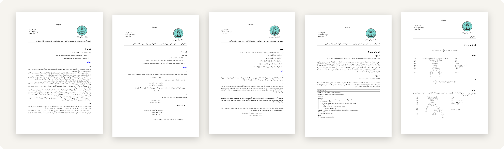
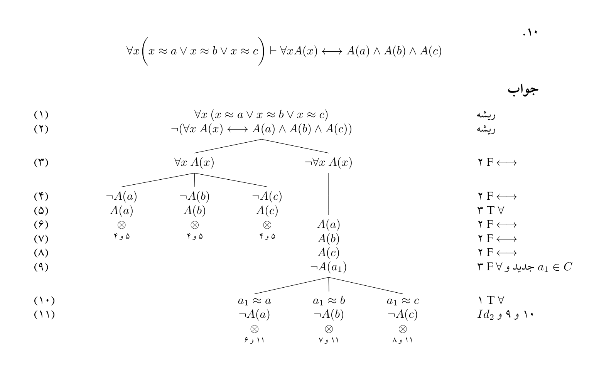
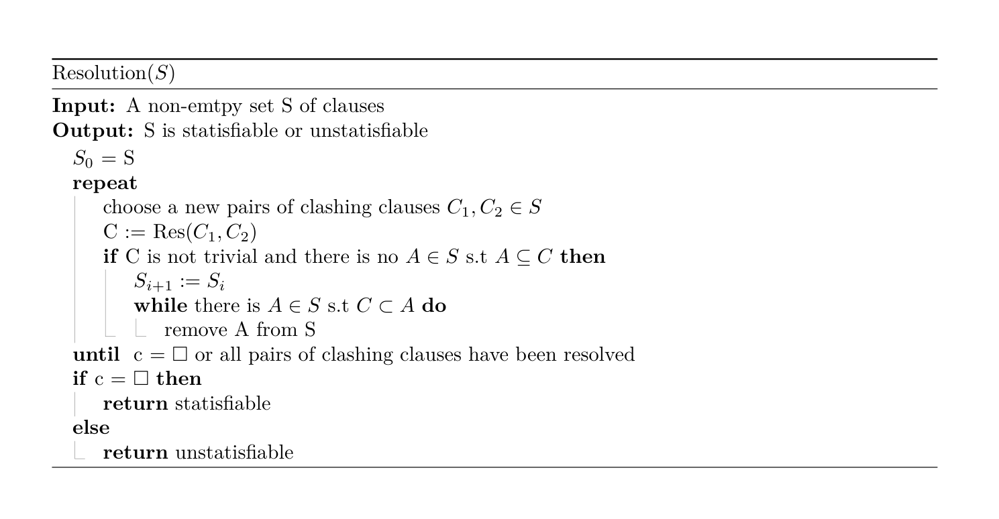

<div align="center">

# Fundamentals of Logic and Set Theory

*Group exercises &nbsp;·&nbsp; University of Isfahan &nbsp;·&nbsp; Spring 2024*

<br>



</div>

<br>

Five problem sets, solved in Persian and typeset with XeLaTeX. They follow the course from propositional logic (how formulas are built, equivalence, consequence and resolution) to first-order logic and semantic tableaux.

| Set | Topic | |
| :-- | :-- | :-- |
| [**E01**](E01) | Structural induction: no formula contains `∧∧` and every formula has an atom; dropping parentheses by precedence; finiteness of the set of subformulas | [PDF](E01/E01.pdf) |
| [**E02**](E02) | Logical equivalence and substitution, and how satisfiability and validity behave when a set of formulas grows or shrinks | [PDF](E02/E02.pdf) |
| [**E03**](E03) | Logical consequence: five properties of U ⊨ A, among them U ⊨ A → B exactly when U, A ⊨ B | [PDF](E03/E03.pdf) |
| [**E04**](E04) | Clauses and resolution: a subsumed clause can be dropped without changing the set, and a resolution procedure built on that | [PDF](E04/E04.pdf) |
| [**E06**](E06) | First-order logic: twelve semantic tableaux, with equality and function symbols, and countermodels for the invalid cases | [PDF](E06/E06.pdf) |

<table>
<tr>
<td width="50%" valign="top">

<p align="center"><sub>A first-order tableau from E06, closing on every branch</sub></p>
</td>
<td width="50%" valign="top">

<p align="center"><sub>Resolution with subsumption, from E04</sub></p>
</td>
</tr>
</table>

## Layout

Each set has a main file, `E0n/E0n.tex`, that pulls its problems in with [subfiles](https://ctan.org/pkg/subfiles). Problem *k* lives in `sections/k/`: `k_0.tex` is the question and `k_1.tex`, `k_2.tex`, … are the answers. Every section also compiles on its own, which helps while writing one.

## Building

You'll need a TeX distribution with XeLaTeX and [xepersian](https://ctan.org/pkg/xepersian), and the XB Niloofar font installed. From the repository root:

```bash
latexmk E06/E06.tex
```

The included `.latexmkrc` selects XeLaTeX, keeps auxiliary files in `out/`, and writes the PDF next to its source.

## Group

Mohammad Mallaee, Davoud Nosrati Amirabadi, Hosna Soltanolkottabi, Farzaneh Salimi and Yeganeh Rastegari, for Dr. Meghdad Ghari's course at the Faculty of Mathematics and Statistics, University of Isfahan.
